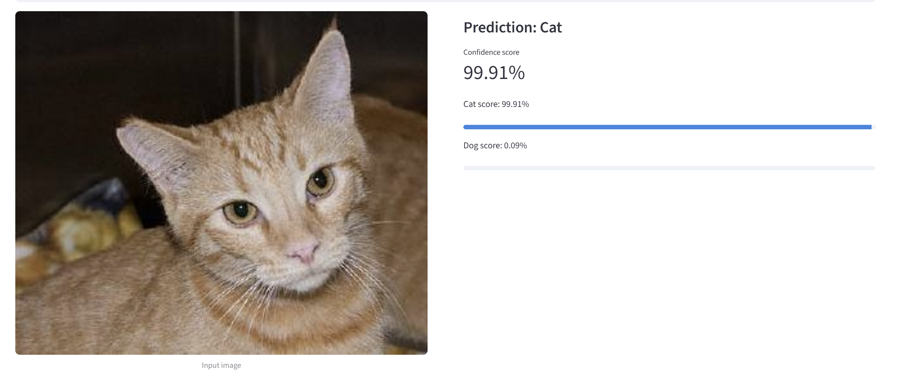
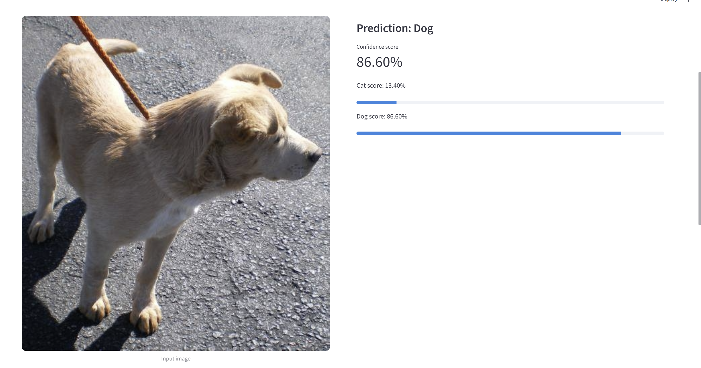
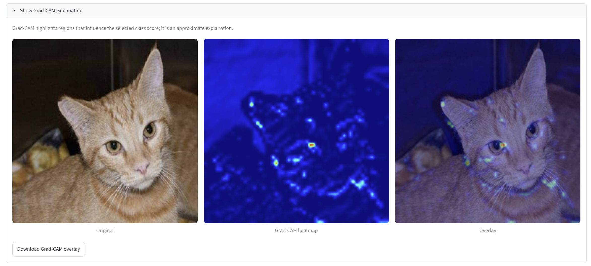
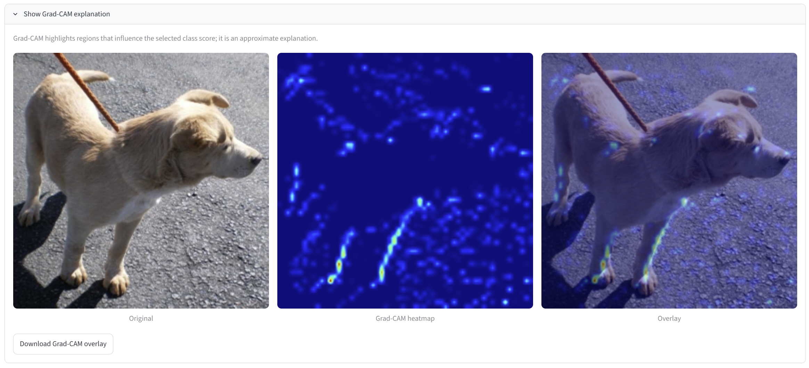
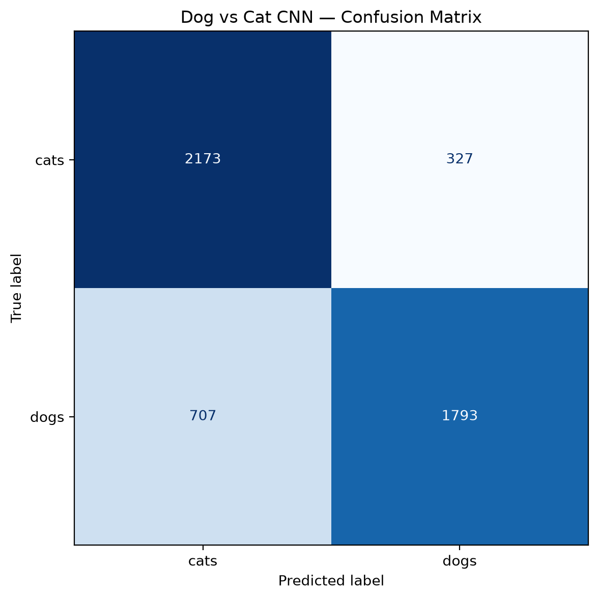

# Dog vs Cat Image Classification using CNN

A deep learning project that uses a custom Convolutional Neural Network (CNN) to classify images of cats and dogs. The project combines image classification, prediction confidence, model evaluation, Grad-CAM explainability, and an interactive Streamlit application.

## Project Overview

This project demonstrates how a custom CNN learns visual features from images to perform binary image classification.

The model predicts one of two classes:

- **Cat**
- **Dog**

An interactive Streamlit application allows users to upload an image, view the predicted class and confidence score, and inspect Grad-CAM visualisations to better understand the model's predictions.

## Key Features

- Custom CNN architecture built using TensorFlow and Keras
- Image resizing and preprocessing
- Binary classification of cats and dogs
- Prediction confidence display
- Confusion matrix for model evaluation
- Grad-CAM heatmaps for both cat and dog predictions
- Interactive Streamlit web application
- Visualisation of model predictions and activation regions

## Project Structure

```text
dog-vs-cat-cnn-gradcam/
│
├── Data/
│   ├── catsvsdogs/
│   ├── train/
│   └── test/
│
├── Models/
│   └── dog_cat_cnn_v1.keras
│
├── Notebooks/
│   └── Dog_vs_Cat.ipynb
│
├── Results/
│   ├── predictions/
│   │   ├── cat_prediction.png
│   │   └── dog_prediction.png
│   │
│   ├── gradcam/
│   │   ├── cat_gradcam.png
│   │   └── dog_gradcam.png
│   │
│   └── confusion_matrix.png
│
├── app.py
├── requirements.txt
├── .gitignore
└── README.md
```

**Note:** The dataset and trained model are excluded from the GitHub repository because of their size. The structure above describes the local project layout; the screenshots and confusion matrix can be committed to GitHub.

## Technologies Used

| Technology | Purpose |
|---|---|
| Python | Programming language |
| TensorFlow / Keras | CNN development and inference |
| NumPy | Numerical operations |
| Matplotlib | Visualisation |
| Scikit-learn | Evaluation metrics |
| Pillow | Image loading and processing |
| Streamlit | Interactive web application |
| Git and GitHub | Version control and project hosting |

## CNN Architecture

The model uses a custom Convolutional Neural Network designed for image classification.

### Main Components

1. **Convolutional layers:** Extract visual patterns such as edges, textures, and shapes.
2. **Activation functions:** Introduce non-linearity into the network.
3. **Pooling layers:** Reduce feature-map dimensions and computational cost.
4. **Flatten layer:** Converts feature maps into a one-dimensional vector.
5. **Dense layers:** Learn higher-level patterns for classification.
6. **Sigmoid output layer:** Produces a probability for binary classification.

### Model Configuration

| Parameter | Value |
|---|---|
| Input image size | 256 × 256 |
| Input channels | 3 (RGB) |
| Number of classes | 2 |
| Output activation | Sigmoid |
| Framework | TensorFlow / Keras |
| Saved model | `Models/dog_cat_cnn_v1.keras` |

## Prediction Results

The Streamlit application accepts an uploaded image and returns the predicted class with a confidence score.

The screenshots below demonstrate the model's predictions for cat and dog images.

### Cat Prediction



### Dog Prediction



These screenshots illustrate the application output. Prediction confidence represents the model's estimated probability and does not guarantee that a prediction is correct.

## Grad-CAM Explainability

**Grad-CAM (Gradient-weighted Class Activation Mapping)** is a visualisation technique used to highlight image regions that contribute to a neural network's prediction.

It uses gradients associated with a target prediction to generate a heatmap over the image. This helps inspect which regions may influence the CNN's decision.

### Cat — Grad-CAM



### Dog — Grad-CAM



Grad-CAM provides an approximate explanation of a model prediction. Highlighted regions should not be interpreted as definitive proof of the features used by the model.

## Model Evaluation

The model was evaluated on 5,000 images.

| Metric | Result |
|---|---:|
| Accuracy | 79.32% |
| Cat recall | 86.92% |
| Dog recall | 71.72% |
| Total images evaluated | 5,000 |

The results indicate that the model identifies cats more effectively than dogs. The difference in recall suggests that the model may benefit from further tuning, data augmentation, and regularisation.

### Confusion Matrix



The confusion matrix compares the actual labels with the model's predicted labels, helping identify correct classifications and misclassifications.

**Evaluation limitation:** The test directory was also used during model development for validation. Therefore, these results should not be considered an independent final test score.

## Installation and Setup

### 1. Clone the Repository

```bash
git clone https://github.com/rihanyawar/dog-vs-cat-cnn-gradcam.git
cd dog-vs-cat-cnn-gradcam
```

### 2. Create a Virtual Environment (Optional)

```bash
python -m venv .venv
```

Activate the environment on Windows PowerShell:

```powershell
.\.venv\Scripts\Activate.ps1
```

### 3. Install Dependencies

```bash
python -m pip install -r requirements.txt
```

### 4. Add the Trained Model

Place the trained model at the following local path:

```text
Models/dog_cat_cnn_v1.keras
```

The model file is not included in this GitHub repository. It must be available locally before running the application.

### 5. Launch the Streamlit Application

From the project root directory, run:

```bash
python -m streamlit run app.py
```

Streamlit will start a local server and provide a browser URL, usually:

```text
http://localhost:8501
```

## Dataset

The project uses a dataset of cat and dog images organised into class-specific directories.

Images are resized to 256 × 256 pixels and processed as RGB inputs before being passed to the CNN.

The dataset is excluded from this repository to keep the source-code repository lightweight.

## Future Improvements

- Apply data augmentation to improve generalisation.
- Experiment with batch normalisation and dropout.
- Compare the custom CNN against transfer-learning models.
- Improve recall for dog classification.
- Evaluate the model on a completely independent test set.
- Add more prediction examples and error analysis.
- Optimise model size and inference speed.
- Configure reliable external model storage for Streamlit Cloud deployment.

## Limitations

- The model may struggle with unusual poses, poor lighting, cluttered backgrounds, or images containing multiple animals.
- Confidence scores are not guarantees of correctness.
- Grad-CAM visualisations are approximate explanations.
- The deployed application requires access to the trained model file.

## Author

**Rihan Yawar**

GitHub: [@rihanyawar](https://github.com/rihanyawar)

## Acknowledgements

This project was developed as a practical application of CNN-based image classification, deep learning model evaluation, and visual explainability.

If you find this project useful, consider giving the repository a star.